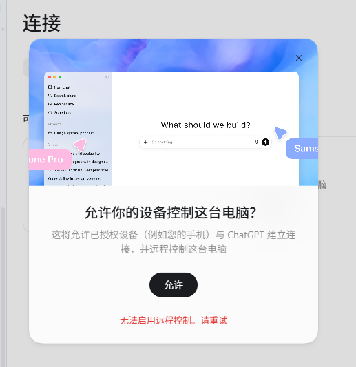

# Codex Remote Control 无法启用：Windows 排查 Skill

**English:** A Codex skill for “Unable to enable Remote Control” on Windows. It distinguishes a working explicit proxy with broken direct traffic, proxy/TUN bypass, Clash Fake-IP route collisions, and account or workspace pairing issues.

在 Windows 版 ChatGPT/Codex Desktop 点击“允许”后，若出现 **“无法启用远程控制。请重试”**，可以安装这个 Codex skill，让 Codex 先收集只读诊断信息，再根据实际结果选择修复方法。

## 问题现象

桌面端能够打开“允许你的设备控制这台电脑？”弹窗，但点击“允许”后显示红色报错，无法进入手机扫码配对步骤：



相同的提示可能由不同故障引起。仅凭这张截图，不能判断是账号权限、代理、TUN，还是虚拟网卡路由的问题。

## 两种网络故障

本仓库针对两类已观察到的网络故障：

| 情况 | 可观察证据 | 处理方向 |
| --- | --- | --- |
| 系统代理可用，但后台连接没有正确经过代理 | 直连远程端点失败，显式代理迅速收到 HTTP 响应；代理软件的 TUN 模式关闭 | 启用正在使用的代理软件的 TUN／全设备模式，或修正分流规则，再重试远程控制 |
| Clash/Mihomo Fake-IP 与 VPN 虚拟网段冲突 | DNS 返回 Fake-IP，`Find-NetRoute` 选择了不该处理它的 VPN 网卡 | 先查清冲突网段，再暂停冲突 VPN 或调整 Fake-IP 地址池 |

### 系统代理可用，TUN 未接管后台连接

在本仓库对应的实际故障中，0dcloud 的系统代理可以访问远程控制端点，但直连连接被重置。检查时 0dcloud 已连接、系统代理已开启，虚拟网卡模式（TUN）却是关闭的。开启 TUN 后，直连探测收到了 HTTP 426，桌面端成功启用远程控制，手机也完成了实际连接。

HTTP 426 只说明普通 HTTP 探测到达了端点，并不等于 WebSocket 配对成功；这里的最终依据是手机实际连上了电脑。

### Clash Fake-IP 被 aTrust 路由截走

另一类案例中，Clash/Mihomo 把 `chatgpt.com` 解析为 `198.18.0.12` 一类的 Fake-IP，地址池使用 `198.18.0.0/16`。同一台 Windows 电脑上的 Sangfor aTrust 虚拟网卡也建立了指向 `198.18.0.0/16` 的路由。Windows 对这个目标地址选择了 aTrust 网卡，请求因此未能按预期进入 Clash TUN，远程控制连接持续超时。显式指定 Clash 代理端口时却能收到 HTTP 响应，帮助将故障缩小到本机 DNS、TUN 和路由路径。

这一类问题要先用 `Resolve-DnsName chatgpt.com` 查看当前解析结果，再用 `Find-NetRoute -RemoteIPAddress <实际返回的 IP>` 核对选中的网卡。确认冲突后，可以在不需要公司 VPN 时暂时停用它，或把 Clash 的 Fake-IP 地址池改到**本机确认未被占用**的网段，并重新加载 TUN、刷新 DNS。`198.19.0.1/16` 只是某台机器上的可用例子，不能直接套用。修改后仍需回到桌面端和手机端验证。

## 安装

在 Codex 中发送：

```text
$skill-installer 安装 https://github.com/mirror30z/codex-remote-control-troubleshooter/tree/main/skills/codex-remote-control-fix
```

安装后，在新对话中发送：

```text
$codex-remote-control-fix 帮我排查 Windows 上“无法启用远程控制。请重试”。
```

也可以手动把 [`skills/codex-remote-control-fix`](skills/codex-remote-control-fix) 文件夹复制到 `~/.codex/skills/`。Skill 包含可选的只读 PowerShell 诊断脚本；它不会自动修改 VPN、路由、防火墙或代理设置。

## 能解决到什么程度

安装 skill 会让 Codex 知道如何定位这类故障，并在证据充分时执行或指导对应修复。它不能保证所有远程控制失败都来自网络，也不能替用户完成账号验证、工作区管理员授权或手机扫码。最终以桌面端出现配对码、手机连接成功并完成一次实际操作为准。

电脑端需要保持运行、联网且不休眠。配对、账号和工作区要求见 [OpenAI Remote connections 官方文档](https://learn.chatgpt.com/docs/remote-connections)。

**English search terms:** ChatGPT Codex Remote Control cannot enable on Windows, unable to enable remote control, Codex mobile pairing, WebSocket ECONNRESET, HTTP 403, proxy TUN, Clash Fake-IP, aTrust route conflict.

## 许可

本项目采用 MIT License。说明和排查步骤由本仓库独立编写，不转载第三方文章。
